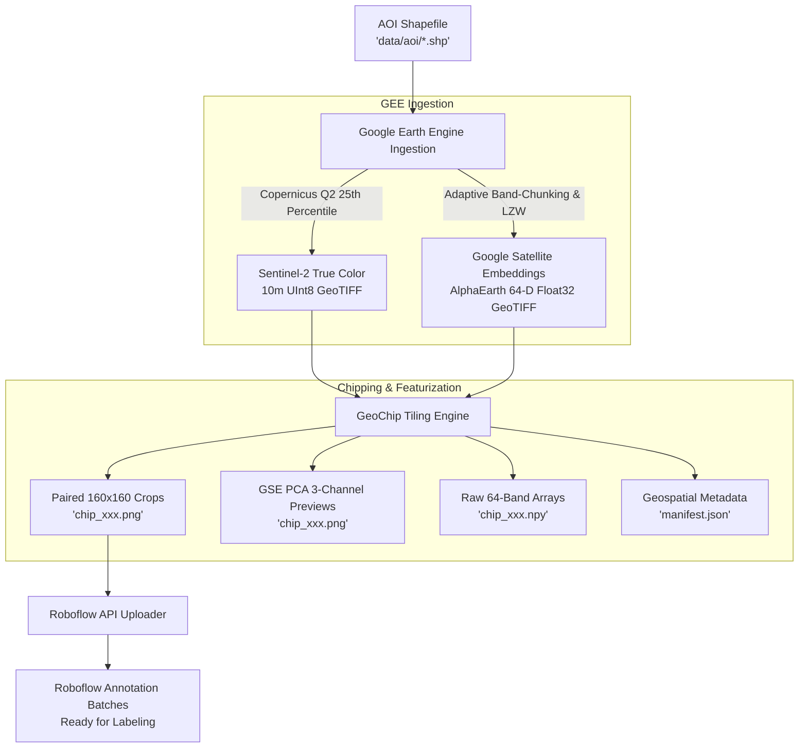

# 🛰️ GeoChip

<p align="center">
  <b>Automated Geospatial Pipeline for Sentinel-2 Imagery & Google Satellite Embeddings Ingestion, Paired Chipping, and Roboflow Annotation</b>
</p>

<p align="center">
  
  
  
  
  
</p>

---

## 📌 Overview

**GeoChip** is a production-ready geospatial data preparation pipeline built for computer vision practitioners and remote sensing researchers. It automates the end-to-end workflow from fetching satellite rasters and foundation model embeddings to generating synchronized, georeferenced image tiles ready for annotation.

### Key Highlights
- **Cloud-Free Sentinel-2 Mosaics (10m)**: Implements the official Copernicus Browser Quarterly Mosaic algorithm (Q2, 25th percentile / first quartile reducer) to eliminate haze and cloud artifacts, exported directly as clean True Color UInt8 GeoTIFFs (~1–3 MB).
- **Google Satellite Embeddings (AlphaEarth 64-D, 10m)**: Seamlessly ingests DeepMind AlphaEarth 64-dimensional foundation model embeddings with **adaptive band-chunking** and **Float32 casting** to reliably bypass the Google Earth Engine 48 MB direct download quota.
- **Paired 160×160 px Chipping**: Tiles Sentinel-2 imagery and GSE rasters into paired crops with configurable valid-pixel coverage thresholds.
- **3-Component PCA Visual Previews**: Automatically projects 64-channel embeddings into human-interpretable 3-channel RGB preview images via Principal Component Analysis and 2–98% percentile stretching, alongside raw 64-band `.npy` arrays.
- **Georeferenced Manifest**: Indexes every chip with its geographic bounding box (`[min_lon, min_lat, max_lon, max_lat]`), pixel offset, and task group in a standardized `manifest.json`.
- **Roboflow Annotation Batches**: Uploads grouped task chip folders directly into Roboflow as distinct annotation batches for immediate annotator assignment.

---

## 🏗️ Architecture & Pipeline Flow



---

## 📂 Repository Structure

```text
GeoChip/
├── data/
│   ├── aoi/                    # ESRI Shapefiles defining Areas of Interest (AOI)
│   ├── raw/                    # Downloaded GeoTIFF rasters (gitignored)
│   └── chips/                  # Tiled paired image chips & manifest (gitignored)
├── geochip/                    # Core Python package
│   ├── __init__.py             # Package exports and version
│   ├── auth.py                 # Earth Engine authentication & diagnostic verification
│   ├── downloader.py           # Sentinel-2 & GSE download routines with adaptive chunking
│   ├── tiler.py                # 160x160 paired chipping, PCA featurization & manifest generator
│   ├── uploader.py             # Roboflow batch annotation uploader
│   └── cli.py                  # Unified Command Line Interface (CLI)
├── main.py                     # CLI entry point
├── auth_setup.py               # Standalone runner for Earth Engine authentication
├── download_data.py            # Standalone runner for downloading satellite rasters
├── create_chips.py             # Standalone runner for image chipping & PCA tiling
├── upload_roboflow.py          # Standalone runner for Roboflow batch uploads
├── .env.example                # Template for environment variables and API keys
├── .gitignore                  # Comprehensive gitignore for rasters and secrets
├── LICENSE                     # MIT License
├── pyproject.toml              # Build system and package configuration
└── requirements.txt            # Python dependencies
```

---

## ⚡ Quickstart

### 1. Installation

Clone this repository and set up a Python virtual environment:

```bash
git clone https://github.com/<your-username>/GeoChip.git
cd GeoChip

# Create and activate virtual environment
python -m venv .venv

# Windows PowerShell:
.\.venv\Scripts\Activate.ps1
# Linux / macOS:
source .venv/bin/activate

# Install dependencies
pip install -r requirements.txt
```

*(Optional) Install in editable mode to use the `geochip` terminal command:*
```bash
pip install -e .
```

---

## 🔑 Authentication Setup

GeoChip connects to **Google Earth Engine (GEE)** and **Roboflow**.

### 1. Google Earth Engine (Choose One Method)

#### Option A: Web Browser OAuth (Recommended)
1. Register for [Google Earth Engine](https://code.earthengine.google.com/register) (Academic, Research, or Non-commercial usage).
2. Note your **Google Cloud Project ID** (e.g. `my-gee-project-123`).
3. Run the login command:
   ```bash
   python auth_setup.py --login --project <YOUR_PROJECT_ID>
   ```
4. Authenticate in your browser. Tokens will be cached securely on your machine.

#### Option B: Google Cloud Service Account
1. Open [Google Cloud Console](https://console.cloud.google.com/) and navigate to **IAM & Admin > Service Accounts**.
2. Create a service account and grant the role **Earth Engine Resource Viewer** (or **Earth Engine User**).
3. Create and download a **JSON Key**.
4. Rename the key to `credentials.json` and place it in the root directory of `GeoChip`.

#### Diagnostic Verification
Verify that both Sentinel-2 and Google Satellite Embeddings catalogs can be queried:
```bash
python auth_setup.py
```

### 2. Roboflow Setup
Create a `.env` file from the example template:
```bash
cp .env.example .env
```
Fill in your Roboflow credentials:
```env
EE_PROJECT_ID=your_gcp_project_id
ROBOFLOW_API_KEY=your_private_api_key
ROBOFLOW_WORKSPACE=your_workspace_slug
ROBOFLOW_PROJECT=your_project_id
```

---

## 🚀 Step-by-Step Usage

### Step 1: Download Sentinel-2 & Embeddings
Download cloud-free Sentinel-2 True Color mosaics and 64-band GSE rasters for a target AOI:

```bash
python download_data.py --aoi data/aoi/AOI-1.shp --mode copernicus-q2 --year 2025
```

**Parameters:**
- `--aoi`: Path to ESRI Shapefile (default: `data/aoi/AOI-1.shp`).
- `--mode`: Composite mode (`copernicus-q2` [default], `annual`, or `window`).
- `--year`: Target year (default: `2025`).
- `--output-dir`: Storage directory (default: `data/raw`).
- `--force`: Force re-download even if cached rasters exist.

---

### Step 2: Generate Paired Chips (160×160 px)
Slice rasters into synchronized tiles, compute PCA visualizations for embeddings, and write `manifest.json`:

```bash
python create_chips.py --aoi AOI-1 --chip-size 160 --chips-per-task 5
```

**Output Structure (`data/chips/AOI-1/`):**
```text
data/chips/AOI-1/
├── manifest.json              # Complete geospatial coordinate indexing
├── Sentinel/
│   ├── task1-AOI-1/           # Contains chip_001.png to chip_005.png
│   ├── task2-AOI-1/           # Contains chip_006.png to chip_010.png
│   └── ...
└── GSE/
    ├── task1-AOI-1/           # Contains chip_001.png (PCA RGB) & chip_001.npy (Raw 64-D)
    ├── task2-AOI-1/
    └── ...
```

---

### Step 3: Upload Batches to Roboflow
Upload task chip folders as separate annotation batches to Roboflow:

```bash
python upload_roboflow.py --aoi AOI-1 --target-type Sentinel --task all
```

Once uploaded, navigate to your **Roboflow Dashboard > Annotate** tab to assign batches to individual annotators.

---

## 🛠️ Unified CLI Pipeline

You can also run all steps via the unified `main.py` entry point:

```bash
# Check auth
python main.py auth

# Download rasters
python main.py download --aoi data/aoi/AOI-1.shp

# Generate chips
python main.py chip --aoi AOI-1

# Upload chips to Roboflow
python main.py upload --aoi AOI-1

# Or run the complete automated pipeline in one command:
python main.py pipeline --aoi-path data/aoi/AOI-1.shp --upload
```

---

## 📜 Metadata Specification (`manifest.json`)

Each entry in `manifest.json` provides complete geospatial context for downstream model training and spatial analysis:

```json
{
  "chip_id": 1,
  "chip_name": "chip_001.png",
  "task_name": "task1-AOI-1",
  "aoi": "AOI-1",
  "row_start": 160,
  "col_start": 160,
  "chip_size": 160,
  "bbox_geo": [
    106.273932,
    -6.180049,
    106.288305,
    -6.165676
  ],
  "sentinel_path": "AOI-1/Sentinel/task1-AOI-1/chip_001.png",
  "gse_path": "AOI-1/GSE/task1-AOI-1/chip_001.png"
}
```

---

## 🤝 Contributing

Contributions, issues, and feature requests are welcome! Feel free to check the [issues page](https://github.com/<your-username>/GeoChip/issues).

---

## 📄 License

This project is licensed under the [MIT License](LICENSE).
