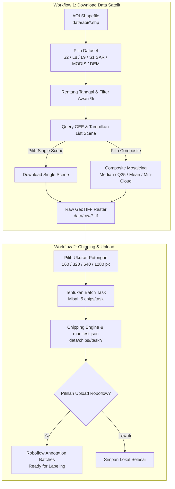

# 🛰️ GeoChip

<p align="center">
  <b>Interactive Geospatial Pipeline for Multi-Satellite Earth Observation Ingestion, Single-Raster Chipping, and Roboflow Annotation Batches</b>
</p>

<p align="center">
  
  
  
  
  
</p>

---

## 📌 Overview

**GeoChip** is an interactive, production-grade geospatial data preparation and computer vision pipeline designed for remote sensing engineers, geospatial data scientists, and ML practitioners. 

GeoChip features a modern terminal user interface (inspired by interactive tools like Antigravity and Claude Code) allowing users to effortlessly discover, filter, composite, download, tile, and upload satellite data directly into annotation pipelines.

### 🌟 Key Highlights

- **Interactive Terminal Experience**: Smooth, arrow-key navigation (`↑/↓` + `Enter`), dynamic live status banners, and intuitive prompts for selecting datasets, dates, thresholds, and workflows.
- **Multi-Sensor Earth Observation Catalog**:
  - **Copernicus Sentinel-2 L2A (10m)**: High-resolution multispectral imagery with QA60 / SCL cloud masking.
  - **USGS Landsat 9 OLI-2 & Landsat 8 OLI C2 L2 (30m)**: Accurate surface reflectance with QA_PIXEL masking.
  - **Copernicus Sentinel-1 SAR GRD (10m)**: C-Band Synthetic Aperture Radar (all-weather, day & night, penetrates clouds).
  - **MODIS Terra Daily Surface Reflectance (250m/500m)**: High temporal frequency for large-area monitoring.
  - **NASA SRTM Digital Elevation Model (30m)**: Global topography and terrain elevation.
- **Flexible Date & Cloud Filtering**: Set custom start/end dates and cloud cover percentage thresholds (0–100%).
- **Scene Discovery & Dual Ingestion Modes**: Inspect all matching scene IDs, dates, and cloud percentages with the option to:
  - **Download a Single Scene**: Choose any individual scene (e.g., the clearest single acquisition).
  - **Generate a Composite**: Merge all matching scenes using customizable reducers (**Median**, **Copernicus Q2 25th Percentile**, **Mean**, or **Min-Cloud Mosaic**).
- **Single-Raster Chipping Engine**: Slices downloaded GeoTIFFs into uniform tiles (**160×160**, **320×320**, **640×640**, or **1280×1280 px**) with valid-coverage filtering and automatic RGB/Grayscale normalization.
- **Batch Task Organization & Georeferenced Manifest**: Groups tiles into task batches (e.g., 5, 10, or 20 chips per task) indexed by a standardized `manifest.json` with WGS84 geographic coordinates.
- **Interactive Roboflow Ingestion**: Direct upload to target Roboflow projects as distinct Annotation Batches, or save locally and skip uploading.
- **Streamlined GEE Authentication**: Uses official Google Earth Engine browser-based OAuth (**Option A**), removing service account complexities.

---

## 🏗️ Architecture & Workflows



---

## 📂 Repository Structure

```text
GeoChip/
├── data/
│   ├── aoi/                    # ESRI Shapefiles defining Areas of Interest (AOI)
│   ├── raw/                    # Downloaded GeoTIFF rasters (gitignored)
│   └── chips/                  # Tiled image chips & manifest.json (gitignored)
├── geochip/                    # Core Python package
│   ├── __init__.py             # Package exports and version (v2.0.0)
│   ├── auth.py                 # Google Earth Engine browser OAuth (Option A)
│   ├── datasets.py             # Earth Observation dataset registry & cloud masks
│   ├── downloader.py           # Interactive scene query, compositing & download engine
│   ├── tiler.py                # Single-raster tiling (160/320/640/1280 px) & manifest
│   ├── uploader.py             # Roboflow batch annotation uploader
│   ├── ui.py                   # Terminal UI engine (arrow keys, formatting, colors)
│   └── cli.py                  # Unified interactive & argument-driven CLI
├── main.py                     # Primary interactive CLI entry point
├── auth_setup.py               # Standalone runner for GEE OAuth setup
├── download_data.py            # Standalone runner for Workflow 1 (Download)
├── create_chips.py             # Standalone runner for Workflow 2 (Chipping)
├── upload_roboflow.py          # Standalone runner for Roboflow batch upload
├── .env.example                # Template for environment variables and API keys
├── .gitignore                  # Git ignore rules for rasters, chips, and secrets
├── LICENSE                     # MIT License
├── pyproject.toml              # Build system and package configuration
└── requirements.txt            # Python dependencies
```

---

## ⚡ Quickstart

### 1. Installation

Clone this repository and create a Python virtual environment:

```bash
git clone https://github.com/<your-username>/GeoChip.git
cd GeoChip

# Create virtual environment
python -m venv .venv

# Activate virtual environment
# Windows PowerShell:
.\.venv\Scripts\Activate.ps1
# Linux / macOS:
source .venv/bin/activate

# Install dependencies
pip install -r requirements.txt
```

*(Optional) Install in editable mode for the `geochip` terminal command:*
```bash
pip install -e .
```

---

## 🔑 Authentication & Secrets Management

### 1. Google Earth Engine (Option A: Browser OAuth)
GeoChip uses **Option A** (browser OAuth):
1. Pastikan Anda memiliki akun [Google Earth Engine](https://code.earthengine.google.com/register).
2. Siapkan **Google Cloud Project ID** Anda (contoh: `my-gee-project-123`).
3. Jalankan perintah autentikasi:
   ```bash
   python auth_setup.py --login
   ```
4. Browser akan terbuka otomatis. Login dengan akun Google Anda dan berikan izin. Token akan disimpan aman di kredensial lokal mesin Anda, dan Project ID akan disimpan ke file `.env`.

### 2. Secrets Management (Lokal vs GitHub Secrets)

> [!IMPORTANT]
> **Penyimpanan Lokal vs Remote:**
> - **Lokal:** Semua API key dan ID rahasia (seperti `ROBOFLOW_API_KEY`, `ROBOFLOW_WORKSPACE`, `ROBOFLOW_PROJECT`, `EE_PROJECT_ID`) disimpan di file `.env` di root repository. File `.env` **sudah otomatis masuk `.gitignore`** sehingga tidak akan pernah ter-commit atau bocor ke publik.
> - **GitHub Secrets:** Git `push` secara desain **tidak mengirimkan secret** ke GitHub demi keamanan. Untuk menyinkronkan secret ke GitHub Actions / repository remote:
>   1. **Via Web:** Buka repositori GitHub > **Settings** > **Secrets and variables** > **Actions** > **New repository secret**.
>   2. **Via GitHub CLI (`gh`):**
>      ```bash
>      gh secret set ROBOFLOW_API_KEY --body "your_key_here"
>      gh secret set EE_PROJECT_ID --body "your_project_id"
>      ```

Contoh konfigurasi `.env`:
```env
EE_PROJECT_ID=my-gcp-project-id
ROBOFLOW_API_KEY=your_private_api_key_here
ROBOFLOW_WORKSPACE=my-workspace-slug
ROBOFLOW_PROJECT=satellite-object-detection
```

---

## 🚀 Interactive CLI Usage

Jalankan perintah utama untuk membuka antarmuka interaktif:

```bash
python main.py
```

Anda akan disuguhkan menu interaktif:

```text
  ██████╗ ███████╗ ██████╗  ██████╗██╗  ██╗██╗██████╗ 
 ██╔════╝ ██╔════╝██╔═══██╗██╔════╝██║  ██║██║██╔══██╗
 ██║  ███╗█████╗  ██║   ██║██║     ███████║██║██████╔╝
 ██║   ██║██╔══╝  ██║   ██║██║     ██╔══██║██║██╔═══╝ 
 ╚██████╔╝███████╗╚██████╔╝╚██████╗██║  ██║██║██║     
  ╚═════╝ ╚══════╝ ╚═════╝  ╚═════╝╚═╝  ╚═╝╚═╝╚═╝     
  Geospatial Earth Observation Pipeline & Roboflow Ingestion

 ? Pilih Workflow yang Ingin Dijalankan:
   ❯ [1] 📥 Workflow 1: Download Data Satelit (Earth Engine)
     [2] ✂️  Workflow 2: Chipping & Upload ke Roboflow
     [3] 🔑 Setup Autentikasi GEE (OAuth Browser Option A)
     [4] ❌ Keluar
```

---

### 📥 Workflow 1: Download Data Satelit

Langkah-langkah interaktif:
1. **Pilih AOI**: Sistem otomatis mendeteksi shapefile di `data/aoi/` (misal: `AOI-1.shp`).
2. **Pilih Dataset Satelit**:
   - `Copernicus Sentinel-2 L2A (10m)`
   - `USGS Landsat 9 OLI-2 / TIRS-2 C2 L2 (30m)`
   - `USGS Landsat 8 OLI / TIRS C2 L2 (30m)`
   - `Copernicus Sentinel-1 SAR GRD (10m Radar - Tembus Awan)`
   - `MODIS Terra Daily Surface Reflectance (250m/500m)`
   - `NASA SRTM Digital Elevation Model (30m Topografi)`
3. **Pilih Rentang Tanggal**: Masukkan tanggal mulai & akhir (format `YYYY-MM-DD`).
4. **Filter Cloud Percentage**: Masukkan batas maksimal tutupan awan (misal `20%`). *Catatan: Otomatis dilewati untuk radar dan DEM.*
5. **Daftar Scene & Pilihan Unduhan**:
   - Menampilkan tabel scene (ID scene, tanggal capture, persentase awan).
   - Opsi: **Unduh Single Scene** pilihan Anda, ATAU **Composite Seluruh Scene** dengan reducer:
     - *Median Composite* (standar de-clouding)
     - *Copernicus Q2 25th Percentile* (kualitas visual kontras tinggi)
     - *Mean Average Composite*
     - *Min-Cloud Mosaic*
6. **Ekspor & Download**: Hasil raster disimpan langsung ke `data/raw/<dataset>_<aoi>_<metadata>.tif` dalam format UInt8 GeoTIFF siap pakai.

---

### ✂️ Workflow 2: Chipping & Upload ke Roboflow

Langkah-langkah interaktif:
1. **Pilih Raw Raster**: Pilih citra GeoTIFF yang ada di folder `data/raw/`.
2. **Pilih Ukuran Potongan Clip**:
   - `160 x 160 px`
   - `320 x 320 px`
   - `640 x 640 px` (standar Roboflow / YOLO)
   - `1280 x 1280 px`
3. **Tentukan Jumlah Batch Task**: Tentukan berapa banyak chip dalam tiap folder task (misal: `5`, `10`, atau `20` chip per task).
4. **Proses Chipping**:
   - Sistem memotong citra secara merata, mengabaikan area kosong/nodata (`>70% valid pixel threshold`), dan menyimpannya sebagai PNG di `data/chips/<nama_raster>/task*/`.
   - Menghasilkan file georeferensi `manifest.json`.
5. **Pilihan Upload Roboflow**:
   - **Upload Sekarang**: Pilih/konfirmasi project Roboflow tujuan, dan kirim task batch langsung ke Roboflow.
   - **Simpan Lokal Saja**: Selesai tanpa upload, hasil potongan tetap tersimpan rapi di folder lokal.

---

## 📜 Spesifikasi Manifest (`manifest.json`)

Setiap proses pemotongan menghasilkan `manifest.json` yang mencatat koordinat geografis WGS84 untuk setiap chip:

```json
{
  "source_raster": "sentinel-2_AOI-1_2025-01-01_2025-03-31_median.tif",
  "crs": "EPSG:4326",
  "chip_size": 640,
  "chips_per_task": 5,
  "total_chips": 20,
  "total_tasks": 4,
  "chips": [
    {
      "chip_id": "chip_0001",
      "task": "task1-sentinel-2_AOI-1",
      "relative_path": "task1-sentinel-2_AOI-1/chip_0001.png",
      "pixel_bbox": [0, 0, 640, 640],
      "geo_bbox": [106.273932, -6.180049, 106.331505, -6.122476],
      "dimensions": [640, 640],
      "valid_coverage": 0.985
    }
  ]
}
```

---

## 💻 Headless / Scripting Usage

Bagi pengguna yang ingin menjalankan perintah via skrip atau CI/CD otomatis tanpa prompt interaktif:

```bash
# Workflow 1: Download via standalone script
python download_data.py

# Workflow 2: Chipping via standalone script
python create_chips.py --raster data/raw/sentinel-2_AOI-1_median.tif --chip-size 640 --chips-per-task 5

# Upload via standalone script
python upload_roboflow.py --chips-dir data/chips/sentinel-2_AOI-1/
```

---

## 📄 License

This project is licensed under the [MIT License](LICENSE).
