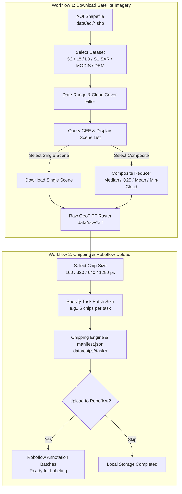

# 🛰️ GeoChip

<p align="center">
  <b>Interactive Geospatial Pipeline for Multi-Satellite Earth Observation Ingestion, Single-Raster Chipping, and Roboflow Annotation Batches</b>
</p>

<p align="center">
  
  
  
  
  
  
</p>

```text
  ██████╗ ███████╗ ██████╗  ██████╗██╗  ██╗██╗██████╗ 
 ██╔════╝ ██╔════╝██╔═══██╗██╔════╝██║  ██║██║██╔══██╗
 ██║  ███╗█████╗  ██║   ██║██║     ███████║██║██████╔╝
 ██║   ██║██╔══╝  ██║   ██║██║     ██╔══██║██║██╔═══╝ 
 ╚██████╔╝███████╗╚██████╔╝╚██████╗██║  ██║██║██║     
  ╚═════╝ ╚══════╝ ╚═════╝  ╚═════╝╚═╝  ╚═╝╚═╝╚═╝     
  Geospatial Earth Observation Pipeline & Roboflow Ingestion
  Interactive CLI Engine v2.0
```

---

## 📌 Overview

**GeoChip** is a production-ready geospatial data preparation and computer vision pipeline designed for remote sensing engineers, geospatial data scientists, and ML practitioners. 

GeoChip features an interactive terminal user interface (inspired by modern developer tools like Antigravity and Claude Code) allowing users to discover, filter, composite, download, tile, and upload satellite data directly into computer vision annotation pipelines—either on a local machine or inside an isolated **Docker** container.

### 🌟 Key Highlights

- **Interactive Terminal Experience**: Seamless arrow-key navigation (`↑/↓` + `Enter`), dynamic status banners, and guided prompts for selecting datasets, dates, thresholds, and workflows.
- **Multi-Sensor Earth Observation Catalog**:
  - **Copernicus Sentinel-2 L2A (10m)**: High-resolution multispectral optical imagery with QA60 and SCL cloud masking.
  - **USGS Landsat 9 OLI-2 & Landsat 8 OLI C2 L2 (30m)**: Calibrated surface reflectance with QA_PIXEL masking.
  - **Copernicus Sentinel-1 SAR GRD (10m)**: C-Band Synthetic Aperture Radar (all-weather, day & night, cloud-penetrating).
  - **MODIS Terra Daily Surface Reflectance (250m/500m)**: High temporal revisit for regional and time-series monitoring.
  - **NASA SRTM Digital Elevation Model (30m)**: Global topography and terrain elevation.
- **Flexible Date & Cloud Filtering**: Set custom observation windows (start and end dates) and cloud cover percentage thresholds (0–100%).
- **Scene Discovery & Dual Ingestion Modes**: Inspect all matching scene IDs, dates, and cloud percentages with the choice to:
  - **Download a Single Scene**: Choose an individual acquisition (e.g., the clearest single acquisition).
  - **Generate a Composite**: Merge multiple scenes using customizable reducers (**Median**, **Copernicus Q2 25th Percentile**, **Mean**, or **Min-Cloud Mosaic**).
- **Single-Raster Chipping Engine**: Slices downloaded GeoTIFFs into uniform tiles (**160×160**, **320×320**, **640×640**, or **1280×1280 px**) with valid-coverage filtering and automatic RGB/Grayscale normalization.
- **Batch Task Organization & Georeferenced Manifest**: Groups tiles into task batches (e.g., 5, 10, or 20 chips per task) indexed by a standardized `manifest.json` with WGS84 geographic bounding boxes.
- **Interactive Roboflow Ingestion**: Direct upload to target Roboflow projects as distinct Annotation Batches, or save locally and skip uploading.
- **Docker Containerization**: Eliminates C++ geospatial library conflicts (GDAL, PROJ, GEOS) across different operating systems with a single command.

---

## 🏗️ Architecture & Pipeline Flow



---

## 📂 Repository Structure

```text
GeoChip/
├── .github/
│   └── workflows/
│       ├── ci.yml              # CI: Linting & offline unit tests across Python 3.10-3.12
│       └── docker-publish.yml  # CD: Automated Docker image build and push to GHCR
├── data/
│   ├── aoi/                    # ESRI Shapefiles defining Areas of Interest (AOI)
│   ├── raw/                    # Downloaded GeoTIFF rasters (gitignored)
│   └── chips/                  # Tiled image chips & manifest.json (gitignored)
├── geochip/                    # Core Python package
│   ├── __init__.py             # Package exports and version (v2.0.0)
│   ├── auth.py                 # Interactive Earth Engine & Roboflow credentials management
│   ├── datasets.py             # Earth Observation dataset registry & cloud masks
│   ├── downloader.py           # Interactive scene query, compositing & download engine
│   ├── tiler.py                # Single-raster tiling (160/320/640/1280 px) & manifest
│   ├── uploader.py             # Roboflow batch annotation uploader
│   ├── ui.py                   # Terminal UI engine (arrow keys, formatting, colors)
│   └── cli.py                  # Unified interactive & argument-driven CLI
├── tests/
│   └── test_pipeline.py        # Offline unit & integration tests (dummy synthetic rasters)
├── main.py                     # Primary interactive CLI entry point
├── auth_setup.py               # Standalone runner for credentials setup
├── download_data.py            # Standalone runner for Workflow 1 (Download)
├── create_chips.py             # Standalone runner for Workflow 2 (Chipping)
├── upload_roboflow.py          # Standalone runner for Roboflow batch upload
├── Dockerfile                  # Container definition with GDAL system libraries
├── docker-compose.yml          # Docker Compose with volume mounts & interactive TTY
├── .dockerignore               # Docker build context exclusions
├── .env.example                # Template for environment variables and API keys
├── .gitignore                  # Git ignore rules for rasters, chips, and secrets
├── LICENSE                     # MIT License
├── pyproject.toml              # Build system and package configuration
└── requirements.txt            # Python dependencies
```

---

## ⚡ Quickstart

You can run GeoChip using either **Method 1 (Docker - Recommended)** to avoid installing geospatial C++ libraries on your host system, or **Method 2 (Local Python Environment)**.

---

### Method 1: Using Docker (Recommended)

Docker isolates all underlying geospatial dependencies (GDAL, PROJ, GEOS) inside a pre-configured Linux container.

#### Beginner Setup Guide for Docker Desktop

<details>
<summary><b> Click here for Windows Setup Guide</b></summary>

Follow these steps if you are setting up Docker Desktop on Windows for the first time:

1. **Verify Hardware Virtualization:** Open Windows Task Manager (`Ctrl + Shift + Esc`) > **Performance** > **CPU** > confirm that **Virtualization: Enabled** is shown. (If disabled, enable Intel VT-x or AMD-V in your BIOS/UEFI settings).
2. **Install WSL 2 (Windows Subsystem for Linux):**
   - Open **PowerShell** as Administrator.
   - Run:
     ```powershell
     wsl --install
     ```
   - If WSL is already installed, update it to the latest version:
     ```powershell
     wsl --update
     ```
   - Restart your computer if prompted.
3. **Download & Install Docker Desktop:**
   - Download the installer from the [Official Docker Desktop for Windows Guide](https://docs.docker.com/desktop/setup/install/windows-install/).
   - Run the installer and ensure the option **"Use WSL 2 instead of Hyper-V"** is checked.
4. **Skip Account Sign-In / Survey (Optional):**
   - When Docker Desktop launches, an account is **not required** for local usage.
   - Click **"Continue without signing in"** (or "Skip") and dismiss the survey.
5. **Keep Docker Desktop Running:**
   - Docker Desktop must be running (green whale icon in the Windows taskbar system tray) when executing GeoChip.
   - *Tip:* Go to **Settings (Gear Icon) > General** and check **"Start Docker Desktop when you log in"**.

</details>

<details>
<summary><b> Click here for macOS Setup Guide</b></summary>

Follow these steps for macOS:

1. **Identify Mac Chip:** Click the Apple logo () > **About This Mac**. Check whether your Mac uses **Apple Silicon** (M1/M2/M3/M4) or an **Intel Processor**.
2. **Download & Install Docker Desktop:**
   - Visit the [Official Docker Desktop for Mac Guide](https://docs.docker.com/desktop/setup/install/mac-install/).
   - Select **"Mac with Apple chip"** or **"Mac with Intel chip"** according to your machine.
   - Open `Docker.dmg`, drag the Docker icon to your **Applications** folder, and launch Docker.
3. **Skip Account Sign-In / Survey (Optional):**
   - Click **"Continue without signing in"** (or "Skip").
4. **Keep Docker Desktop Running:**
   - Ensure the Docker whale icon is active in the top menu bar before running GeoChip.

</details>

---

#### Running with Docker Compose

With Docker Desktop running, open a terminal in the cloned repository directory and execute:

```bash
docker compose run --rm geochip
```

> [!TIP]
> The provided [docker-compose.yml](file:///c:/Users/bayun/OneDrive/Documents/GitHub/GeoChip/docker-compose.yml) is pre-configured with:
> - **Volume Mount `./data:/app/data`**: All input AOIs, downloaded GeoTIFFs, and generated chips persist directly on your host machine.
> - **Shared GEE Credentials**: Mounts `~/.config/earthengine` from your host machine so you do not need to re-authenticate inside the container.
> - **Interactive TTY**: Enables keyboard navigation (`↑/↓` arrows, Enter) and ANSI colors inside Docker.

Alternatively, running with standard Docker commands:
```bash
# Build image
docker build -t geochip .

# Run interactively
docker run -it --rm -v ${PWD}/data:/app/data geochip
```

---

### Method 2: Using Local Python Environment

If you prefer to run directly on your host machine:

```bash
# 1. Clone repository
git clone https://github.com/<your-username>/GeoChip.git
cd GeoChip

# 2. Create virtual environment (Python 3.10 - 3.12)
python -m venv .venv

# 3. Activate virtual environment
# Windows PowerShell:
.\.venv\Scripts\Activate.ps1
# Linux / macOS:
source .venv/bin/activate

# 4. Install dependencies
pip install -r requirements.txt

# (Optional) Install in editable mode to enable the 'geochip' CLI command
pip install -e .

# 5. Launch GeoChip
python main.py
```

---

## 🔑 Authentication & Credentials Setup

GeoChip connects to **Google Earth Engine (GEE)** and **Roboflow**. Both can be configured directly through the terminal UI.

### Configuring Credentials via Terminal UI (Recommended)
You can configure and verify all credentials without editing files manually:
1. Run `python main.py` and select **`🔑 Setup Credentials & Authentication`**.
2. **Google Earth Engine Login**: Opens your web browser automatically to authenticate your Google account and caches the token locally in `~/.config/earthengine`.
3. **Roboflow Setup**: Prompts for your Private API Key, Workspace Slug, and Project ID, saving them securely to `.env`.
4. **Test Connections**: Validates that both services are accessible and authenticated.

### Manual Configuration via `.env` (Alternative)
Copy the template [`.env.example`](file:///c:/Users/bayun/OneDrive/Documents/GitHub/GeoChip/.env.example) to `.env`:
```bash
cp .env.example .env
```
Fill in your credentials:
```env
EE_PROJECT_ID=my-gcp-project-id
ROBOFLOW_API_KEY=your_private_api_key_here
ROBOFLOW_WORKSPACE=my-workspace-slug
ROBOFLOW_PROJECT=satellite-object-detection
```

> [!NOTE]
> The `.env` file is automatically ignored by `.gitignore` to prevent confidential keys from being committed to source control.

---

## 🚀 Interactive CLI Walkthrough

Launch the application:
```bash
python main.py
```

The interactive menu will display:

```text
? Select Workflow to Execute:
  ❯ [1] 📥 Workflow 1: Download Satellite Imagery (Earth Engine)
    [2] ✂️  Workflow 2: Chipping & Upload to Roboflow
    [3] 🔑 Setup Credentials & Authentication
    [4] ❌ Exit
```

---

### 📥 Workflow 1: Download Satellite Imagery
1. **Select AOI**: Automatically detects shapefiles in `data/aoi/` (e.g., `AOI-1.shp`).
2. **Select Satellite Dataset**:
   - `Copernicus Sentinel-2 L2A (10m)`
   - `USGS Landsat 9 OLI-2 / TIRS-2 C2 L2 (30m)`
   - `USGS Landsat 8 OLI / TIRS C2 L2 (30m)`
   - `Copernicus Sentinel-1 SAR GRD (10m Radar - Cloud-Proof)`
   - `MODIS Terra Daily Surface Reflectance (250m/500m)`
   - `NASA SRTM Digital Elevation Model (30m Topography)`
3. **Select Date Range**: Enter start and end dates (format `YYYY-MM-DD`).
4. **Cloud Cover Filter**: Enter maximum acceptable cloud percentage (e.g., `20%`). *Automatically skipped for Radar and DEM datasets*.
5. **Scene Listing & Ingestion Mode**:
   - Displays all matching acquisitions (Scene ID, capture date, cloud cover percentage).
   - **Download Single Scene**: Select an individual acquisition.
   - **Composite All Scenes**: Merge scenes using a reducer:
     - *Median Composite* (standard de-clouding)
     - *Copernicus Q2 25th Percentile* (high-contrast, haze-free)
     - *Mean Average Composite*
     - *Min-Cloud Mosaic*
6. **Export & Download**: The raster is exported directly to `data/raw/<dataset>_<aoi>_<metadata>.tif` as a clean True Color UInt8 GeoTIFF.

---

### ✂️ Workflow 2: Chipping & Upload to Roboflow
1. **Select Raw Raster**: Choose any GeoTIFF raster located in `data/raw/`.
2. **Select Chip Tile Size**:
   - `160 x 160 px`
   - `320 x 320 px`
   - `640 x 640 px` (standard YOLO & Roboflow format)
   - `1280 x 1280 px`
3. **Specify Chips per Task**: Determine how many tiles are bundled in each task batch folder (e.g., `5`, `10`, or `20`).
4. **Chipping Execution**:
   - Slices the raster across a grid, filters out empty/nodata regions (`>70% valid pixel threshold`), and exports chips to `data/chips/<raster_stem>/task*/`.
   - Generates geographic coordinates index in `manifest.json`.
5. **Roboflow Upload Selection**:
   - **Upload Now**: Confirms the target Roboflow project and sends batches for annotator assignment.
   - **Save Locally Only**: Completes the process without uploading.

---

## 📜 Manifest Specification (`manifest.json`)

Each chipping execution creates a standardized `manifest.json` indexing WGS84 geographic bounding boxes and pixel offsets for every tile:

```json
{
  "source_raster": "sentinel-2_AOI-1_2025-01-01_2025-03-31_median.tif",
  "crs": "EPSG:4326",
  "chip_size": 640,
  "chips_per_task": 5,
  "total_chips": 20,
  "total_tasks": 4,
  "chips": [
    {
      "chip_id": "chip_0001",
      "task": "task1-sentinel-2_AOI-1",
      "relative_path": "task1-sentinel-2_AOI-1/chip_0001.png",
      "pixel_bbox": [0, 0, 640, 640],
      "geo_bbox": [106.273932, -6.180049, 106.331505, -6.122476],
      "dimensions": [640, 640],
      "valid_coverage": 0.985
    }
  ]
}
```

---

## 💻 Headless / Scripting Usage

For automated scripts and background tasks without interactive terminal prompts:

```bash
# Workflow 1: Download via standalone script
python download_data.py

# Workflow 2: Chipping via standalone script
python create_chips.py --raster data/raw/sentinel-2_AOI-1_median.tif --chip-size 640 --chips-per-task 5

# Upload via standalone script
python upload_roboflow.py --chips-dir data/chips/sentinel-2_AOI-1/
```

---

## 📄 License

This project is licensed under the [MIT License](LICENSE).
