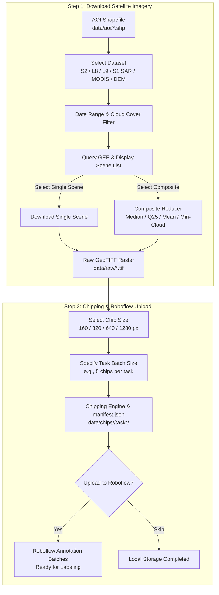

# GeoChip

<p align="center">
  <b>Interactive Geospatial Pipeline for Multi-Satellite Earth Observation Ingestion, Single-Raster Chipping, and Roboflow Annotation Batches</b>
</p>

<p align="center">
  
  
  
  
  
</p>

```text
  ██████╗ ███████╗ ██████╗  ██████╗██╗  ██╗██╗██████╗ 
 ██╔════╝ ██╔════╝██╔═══██╗██╔════╝██║  ██║██║██╔══██╗
 ██║  ███╗█████╗  ██║   ██║██║     ███████║██║██████╔╝
 ██║   ██║██╔══╝  ██║   ██║██║     ██╔══██║██║██╔═══╝ 
 ╚██████╔╝███████╗╚██████╔╝╚██████╗██║  ██║██║██║     
  ╚═════╝ ╚══════╝ ╚═════╝  ╚═════╝╚═╝  ╚═╝╚═╝╚═╝     
  Geospatial Earth Observation Pipeline & Roboflow Ingestion
  Interactive CLI Engine v2.0
```

---

## Overview

**GeoChip** is a production-ready geospatial data preparation and computer vision pipeline designed for remote sensing engineers, geospatial data scientists, and ML practitioners. 

GeoChip features an interactive terminal user interface allowing users to discover, filter, composite, download, tile, and upload satellite data directly into computer vision annotation pipelines either on a local machine or inside an isolated **Docker** container.

### Key Highlights

- **Interactive Terminal Experience**: Seamless arrow-key navigation (`↑/↓` + `Enter`), dynamic status banners, and guided prompts for selecting datasets, dates, thresholds, and workflows.
- **Multi-Sensor Earth Observation Catalog**:
  - **Copernicus Sentinel-2 L2A (10m)**: High-resolution multispectral optical imagery with QA60 and SCL cloud masking.
  - **USGS Landsat 9 OLI-2 & Landsat 8 OLI C2 L2 (30m)**: Calibrated surface reflectance with QA_PIXEL masking.
  - **Copernicus Sentinel-1 SAR GRD (10m)**: C-Band Synthetic Aperture Radar (all-weather, day & night, cloud-penetrating).
  - **MODIS Terra Daily Surface Reflectance (250m/500m)**: High temporal revisit for regional and time-series monitoring.
  - **NASA SRTM Digital Elevation Model (30m)**: Global topography and terrain elevation.
- **Flexible Date & Cloud Filtering**: Set custom observation windows (start and end dates) and cloud cover percentage thresholds (0–100%).
- **Scene Discovery & Dual Ingestion Modes**: Inspect all matching scene IDs, dates, and cloud percentages with the choice to:
  - **Download a Single Scene**: Choose an individual acquisition (e.g., the clearest single acquisition).
  - **Generate a Composite**: Merge multiple scenes using customizable reducers (**Median**, **Copernicus Q2 25th Percentile**, **Mean**, or **Min-Cloud Mosaic**).
- **Single-Raster Chipping Engine**: Slices downloaded GeoTIFFs into uniform tiles (**160×160**, **320×320**, **640×640**, or **1280×1280 px**) with valid-coverage filtering and automatic RGB/Grayscale normalization.
- **Batch Task Organization & Georeferenced Manifest**: Groups tiles into task batches (e.g., 5, 10, or 20 chips per task) indexed by a standardized `manifest.json` with WGS84 geographic bounding boxes.
- **Interactive Roboflow Ingestion**: Direct upload to target Roboflow projects as distinct Annotation Batches, or save locally and skip uploading.
- **Docker Containerization**: Eliminates C++ geospatial library conflicts (GDAL, PROJ, GEOS) across different operating systems with a single command.

---

## Architecture & Pipeline Flow



---

## Repository Structure

```text
GeoChip/
├── .github/
│   └── workflows/
│       ├── ci.yml              # CI: Linting & offline unit tests across Python 3.10-3.12
│       └── docker-publish.yml  # CD: Automated Docker image build and push to GHCR
├── data/
│   ├── aoi/                    # User-supplied ESRI Shapefiles (.shp, .shx, .dbf, .prj)
│   ├── raw/                    # Downloaded GeoTIFF rasters (gitignored)
│   └── chips/                  # Tiled image chips & manifest.json (gitignored)
├── geochip/                    # Core Python package
│   ├── __init__.py             # Package exports and version (v2.0.0)
│   ├── auth.py                 # Interactive Earth Engine & Roboflow credentials management
│   ├── datasets.py             # Earth Observation dataset registry & cloud masks
│   ├── downloader.py           # Interactive scene query, compositing & download engine
│   ├── tiler.py                # Single-raster tiling (160/320/640/1280 px) & manifest
│   ├── uploader.py             # Roboflow batch annotation uploader
│   ├── ui.py                   # Terminal UI engine (arrow keys, formatting, colors)
│   └── cli.py                  # Unified interactive & argument-driven CLI
├── tests/
│   └── test_pipeline.py        # Offline unit & integration tests (dummy synthetic rasters)
├── main.py                     # Primary interactive CLI entry point
├── run_docker.py               # Automated Docker runner (checks/starts Docker Desktop)
├── auth_setup.py               # Standalone runner for credentials setup
├── download_data.py            # Standalone runner for Step 1 (Download)
├── create_chips.py             # Standalone runner for Step 2 (Chipping)
├── upload_roboflow.py          # Standalone runner for Roboflow batch upload
├── Dockerfile                  # Container definition with GDAL system libraries
├── docker-compose.yml          # Docker Compose with volume mounts & interactive TTY
├── .dockerignore               # Docker build context exclusions
├── .env.example                # Template for environment variables and API keys
├── .gitignore                  # Git ignore rules for rasters, chips, and secrets
├── LICENSE                     # MIT License
├── pyproject.toml              # Build system and package configuration
└── requirements.txt            # Python dependencies
```

---

## Quickstart

GeoChip runs inside a pre-configured Docker container to ensure all underlying geospatial C++ libraries (`GDAL`, `PROJ`, `GEOS`) execute without system conflicts across Windows, macOS, and Linux.

### 1. Install Docker Desktop

If Docker Desktop is not yet installed on your system, follow the guide below:

<details>
<summary><b>Click here for Windows Setup Guide</b></summary>

Follow these steps if you are setting up Docker Desktop on Windows for the first time:

1. **Verify Hardware Virtualization:** Open Windows Task Manager (`Ctrl + Shift + Esc`) > **Performance** > **CPU** > confirm that **Virtualization: Enabled** is shown. (If disabled, enable Intel VT-x or AMD-V in your BIOS/UEFI settings).
2. **Install WSL 2 (Windows Subsystem for Linux):**
   - Open **PowerShell** as Administrator.
   - Run:
     ```powershell
     wsl --install
     ```
   - If WSL is already installed, update it to the latest version:
     ```powershell
     wsl --update
     ```
   - Restart your computer if prompted.
3. **Download & Install Docker Desktop:**
   - Download the installer from the [Official Docker Desktop for Windows Guide](https://docs.docker.com/desktop/setup/install/windows-install/).
   - Run the installer and ensure the option **"Use WSL 2 instead of Hyper-V"** is checked.
4. **Skip Account Sign-In / Survey (Optional):**
   - When Docker Desktop launches, an account is **not required** for local usage.
   - Click **"Continue without signing in"** (or "Skip") and dismiss the survey.
5. **Keep Docker Desktop Running:**
   - Docker Desktop must be running when executing GeoChip.
   - *Tip:* Go to **Settings (Gear Icon) > General** and check **"Start Docker Desktop when you log in"**.

</details>

<details>
<summary><b>Click here for macOS Setup Guide</b></summary>

Follow these steps for macOS:

1. **Identify Mac Chip:** Click the Apple logo () > **About This Mac**. Check whether your Mac uses **Apple Silicon** (M1/M2/M3/M4) or an **Intel Processor**.
2. **Download & Install Docker Desktop:**
   - Visit the [Official Docker Desktop for Mac Guide](https://docs.docker.com/desktop/setup/install/mac-install/).
   - Select **"Mac with Apple chip"** or **"Mac with Intel chip"** according to your machine.
   - Open `Docker.dmg`, drag the Docker icon to your **Applications** folder, and launch Docker.
3. **Skip Account Sign-In / Survey (Optional):**
   - Click **"Continue without signing in"** (or "Skip").
4. **Keep Docker Desktop Running:**
   - Ensure the Docker whale icon is active in the top menu bar before running GeoChip.

</details>

<details>
<summary><b>Click here for Linux Setup Guide</b></summary>

Follow these steps for Linux (Ubuntu, Debian, Fedora, Arch, etc.):

**Option A: Native Docker Engine (Recommended for Linux):**
1. Install Docker using the official automated script:
   ```bash
   curl -fsSL https://get.docker.com -o get-docker.sh
   sudo sh get-docker.sh
   ```
2. Add your current user to the `docker` group so you can run Docker without `sudo`:
   ```bash
   sudo usermod -aG docker $USER
   ```
3. Activate the new group membership (or log out and log back in):
   ```bash
   newgrp docker
   ```
4. Start and enable the Docker system service:
   ```bash
   sudo systemctl enable --now docker
   ```

**Option B: Docker Desktop for Linux:**
1. Download the `.deb` or `.rpm` package from the [Official Docker Desktop for Linux Guide](https://docs.docker.com/desktop/setup/install/linux/).
2. Install the package using your package manager:
   ```bash
   # Debian / Ubuntu:
   sudo apt-get install ./docker-desktop-<version>-<arch>.deb
   ```
3. Launch Docker Desktop from your application menu or run:
   ```bash
   systemctl --user start docker-desktop
   ```

</details>

---

### 2. Launch GeoChip

To launch the interactive application, open your terminal in the cloned repository directory and run:

```bash
python main.py
```

> **Automated Docker Desktop Detection & First-Run Setup**:
> When you run `python main.py`, GeoChip performs complete zero-config checks:
> 1. **Engine Check**: If Docker Desktop is closed, GeoChip automatically launches Docker Desktop in the background and waits for it to become ready.
> 2. **Image Check**: If the Docker image (`geochip:latest`) is not yet present on your device, GeoChip automatically builds the image for you before launching.
> 3. **Interactive Session**: GeoChip starts the interactive terminal UI with all your host `data/` directories and credentials mounted seamlessly.

---

## Authentication & Credentials Setup

GeoChip connects to **Google Earth Engine (GEE)** and **Roboflow**. All credentials are configured interactively through the terminal UI—no manual file editing required.

### Configuring Credentials via Terminal UI

1. Launch GeoChip and select **`[3] 🔑 Setup Credentials & Authentication`** from the main menu:
   ```bash
   python main.py
   ```

2. **Google Earth Engine Login (Browser OAuth)**:
   - Select `🌐 Google Earth Engine Login (Browser OAuth)`.
   - The CLI displays a Google authentication link. Open it in your browser, select your Google account, and copy the verification code.
   - Paste the verification code into the terminal prompt.
   - Enter your associated Google Cloud Project ID (e.g., `my-gee-project-123`).
     - *Where to find your Project ID:* Check the [Google Cloud Console](https://console.cloud.google.com/welcome) or your [Earth Engine Code Editor](https://code.earthengine.google.com/).
     - *Project Registration:* Ensure your GCP project is registered for Earth Engine access (free for non-commercial/research use) at the [Earth Engine Cloud Configuration Page](https://console.cloud.google.com/earth-engine/configuration).
   - Credentials are automatically cached to `~/.config/earthengine` and shared with the Docker container via volume mounting.

3. **Roboflow Setup**:
   - Select `🤖 Setup Roboflow API Credentials`.
   - The CLI will prompt you to enter your **Private API Key**, **Workspace ID / Slug**, and **Target Project ID**.
   - These are saved securely to your local `.env` file (gitignored).

4. **Test Connections & Diagnostics**:
   - Select `🔍 Test Connections & Diagnostic Status` to run a live health check confirming connectivity to both Earth Engine and Roboflow.

---

### How to Obtain Your Roboflow Credentials

If you do not know where to find your Roboflow credentials, follow this quick guide:

1. **Roboflow Private API Key**:
   - Log in to your [Roboflow Dashboard](https://app.roboflow.com).
   - In the navigation menu, click your account or workspace avatar > **Settings**.
   - Select **Roboflow API** (or **Workspaces** > select workspace > **Roboflow API**).
   - Under **Private API Key**, click **Show** or **Copy**. *(Keep this secret; it allows downloading and uploading to your datasets).*

2. **Workspace ID / Slug**:
   - In your browser, navigate to your workspace or any project within it.
   - Look at the URL in your browser's address bar:
     ```text
     https://app.roboflow.com/<your-workspace-slug>/...
     ```
   - The text immediately after `app.roboflow.com/` is your **Workspace Slug** (for example: `satellite-vision-lab`).

3. **Target Project ID**:
   - Click on the project where you want to upload satellite imagery chips for labeling.
   - Look at the browser URL:
     ```text
     https://app.roboflow.com/<your-workspace-slug>/<your-project-id>/...
     ```
   - The segment after your workspace slug is your **Project ID** (for example: `port-vessel-detection`).

---

## Interactive CLI Walkthrough

Launch the application:
```bash
python main.py
```

The interactive menu will display:

```text
? Select Step to Execute:
  ❯ [1] 📥 Step 1: Download Satellite Imagery (Earth Engine)
    [2] ✂️ Step 2: Chipping & Upload to Roboflow
    [3] 🔑 Setup Credentials & Authentication
    [4] ❌ Exit
```

---

### Step 1: Download Satellite Imagery

1. **Prepare and Select AOI (Area of Interest)**:
   - Place your custom ESRI Shapefile inside `data/aoi/`.
   - **Required Shapefile Components**: A valid shapefile requires four companion files with the exact same base name:
     - `<name>.shp` — Feature geometry
     - `<name>.shx` — Spatial index
     - `<name>.dbf` — Attribute table
     - `<name>.prj` — Coordinate Reference System (CRS) projection info (WGS84 / EPSG:4326 recommended)
   - *How to create an AOI:* Draw your target boundary on [geojson.io](https://geojson.io) or export a polygon layer from **QGIS** / **ArcGIS** as an ESRI Shapefile.
   - GeoChip automatically scans `data/aoi/` and displays all discovered shapefiles in the terminal menu.
2. **Select Satellite Dataset**:
   - `Copernicus Sentinel-2 L2A (10m)`
   - `USGS Landsat 9 OLI-2 / TIRS-2 C2 L2 (30m)`
   - `USGS Landsat 8 OLI / TIRS C2 L2 (30m)`
   - `Copernicus Sentinel-1 SAR GRD (10m Radar - Cloud-Proof)`
   - `MODIS Terra Daily Surface Reflectance (250m/500m)`
   - `NASA SRTM Digital Elevation Model (30m Topography)`
3. **Select Date Range**: Enter start and end dates (format `YYYY-MM-DD`).
4. **Cloud Cover Filter**: Enter maximum acceptable cloud percentage (e.g., `20%`). *Automatically skipped for Radar and DEM datasets*.
5. **Scene Listing & Ingestion Mode**:
   - Displays all matching acquisitions (Scene ID, capture date, cloud cover percentage).
   - **Download Single Scene**: Select an individual acquisition.
   - **Composite All Scenes**: Merge scenes using a reducer:
     - *Median Composite* (standard de-clouding)
     - *Copernicus Q2 25th Percentile* (high-contrast, haze-free)
     - *Mean Average Composite*
     - *Min-Cloud Mosaic*
6. **Export & Download**: The raster is exported directly to `data/raw/<dataset>_<aoi>_<metadata>.tif` as a clean True Color UInt8 GeoTIFF.

---

### Step 2: Chipping & Upload to Roboflow
1. **Select Raw Raster**: Choose any GeoTIFF raster located in `data/raw/`.
2. **Select Chip Tile Size**:
   - `160 x 160 px`
   - `320 x 320 px`
   - `640 x 640 px` (standard YOLO & Roboflow format)
   - `1280 x 1280 px`
3. **Specify Chips per Task**: Determine how many tiles are bundled in each task batch folder (e.g., `5`, `10`, or `20`).
4. **Chipping Execution**:
   - Slices the raster across a grid, filters out empty/nodata regions (`>70% valid pixel threshold`), and exports chips to `data/chips/<raster_stem>/task*/`.
   - Generates geographic coordinates index in `manifest.json`.
5. **Roboflow Upload Selection**:
   - **Upload Now**: Confirms the target Roboflow project and sends batches for annotator assignment.
   - **Save Locally Only**: Completes the process without uploading.

---

## Manifest Specification (`manifest.json`)

Each chipping execution creates a standardized `manifest.json` indexing WGS84 geographic bounding boxes and pixel offsets for every tile:

```json
{
  "source_raster": "sentinel-2_AOI-1_2025-01-01_2025-03-31_median.tif",
  "crs": "EPSG:4326",
  "chip_size": 640,
  "chips_per_task": 5,
  "total_chips": 20,
  "total_tasks": 4,
  "chips": [
    {
      "chip_id": "chip_0001",
      "task": "task1-sentinel-2_AOI-1",
      "relative_path": "task1-sentinel-2_AOI-1/chip_0001.png",
      "pixel_bbox": [0, 0, 640, 640],
      "geo_bbox": [106.273932, -6.180049, 106.331505, -6.122476],
      "dimensions": [640, 640],
      "valid_coverage": 0.985
    }
  ]
}
```

---

## Headless / Scripting Usage

For automated scripts and background tasks without interactive terminal prompts:

```bash
# Step 1: Download via standalone script
python download_data.py

# Step 2: Chipping via standalone script
python create_chips.py --raster data/raw/sentinel-2_AOI-1_median.tif --chip-size 640 --chips-per-task 5

# Upload via standalone script
python upload_roboflow.py --chips-dir data/chips/sentinel-2_AOI-1/
```

---

## License

This project is licensed under the [MIT License](LICENSE).
